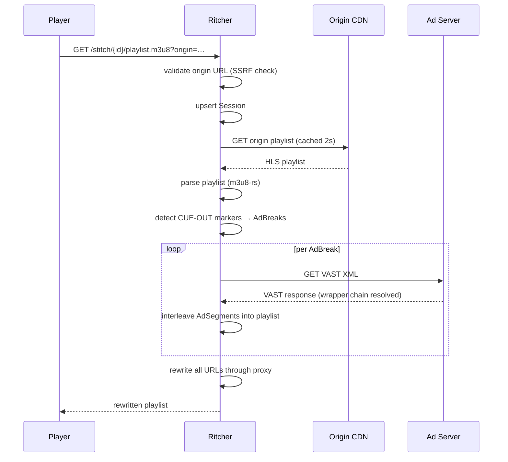
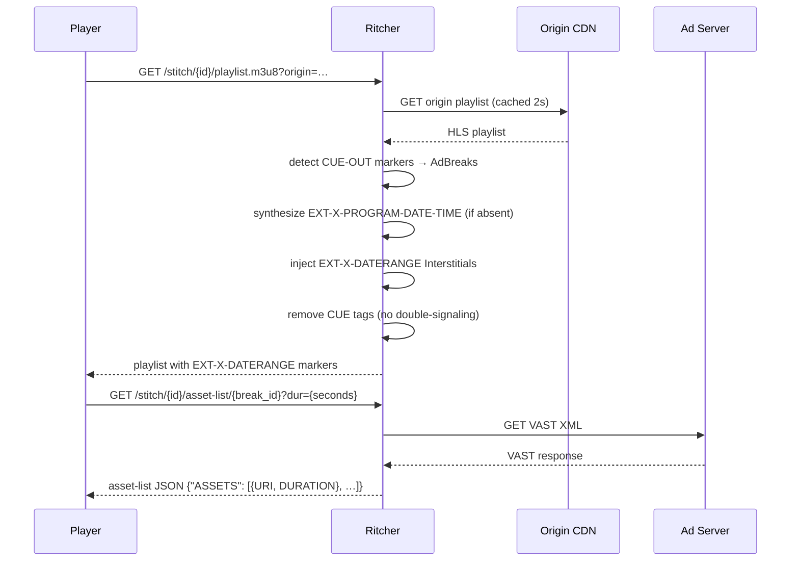

# Architecture

## Component diagram

```mermaid
graph TD
    Player -->|GET /stitch/{id}/playlist.m3u8| Router
    Player -->|GET /stitch/{id}/manifest.mpd| Router
    Player -->|GET /stitch/{id}/segment/*| Router
    Player -->|GET /stitch/{id}/ad/{name}| Router
    Player -->|GET /stitch/{id}/asset-list/{break_id}| Router

    subgraph Ritcher
        Router[Axum router]
        Router --> PlaylistH[playlist handler]
        Router --> ManifestH[manifest handler]
        Router --> SegmentH[segment handler]
        Router --> AdH[ad handler]
        Router --> AssetListH[asset-list handler]

        PlaylistH --> HLS[hls module]
        ManifestH --> DASH[dash module]
        PlaylistH & ManifestH --> AdProv[AdProvider]
        PlaylistH & ManifestH --> Cache[ManifestCache]
        PlaylistH & ManifestH --> Sessions[SessionManager]
        SegmentH --> Retry[RetryPolicy]
        AdH --> AdProv
        AssetListH --> AdProv
    end

    Cache -->|on miss| Origin[Origin CDN]
    SegmentH -->|proxy| Origin
    AdProv -->|VAST fetch| AdServer[Ad Server]
    AdH -->|proxy| AdProv
    AdProv -->|fallback| Slate[Slate Source]

    Sessions -.->|memory backend| DashMap[(DashMap)]
    Sessions -.->|valkey backend| Valkey[(Valkey/Redis)]
```

## Request flow — SSAI playlist



## Request flow — SGAI playlist (HLS Interstitials)



## Module map

| Module | Path | Responsibility |
|--------|------|----------------|
| `config` | `src/config.rs` | Environment-variable configuration (`Config`) |
| `server` | `src/server/` | Axum router, handlers, middleware, `AppState` |
| `hls` | `src/hls/` | HLS playlist parsing, CUE detection, SSAI/SGAI interleaving, LL-HLS |
| `dash` | `src/dash/` | DASH MPD parsing, SCTE-35 detection, SSAI/SGAI |
| `ad` | `src/ad/` | `AdProvider` trait + implementations, VAST, tracking, slate, conditioning |
| `session` | `src/session/` | Per-viewer session store (memory or Valkey) |
| `cache` | `src/cache.rs` | Short-TTL `ManifestCache` for origin manifests |
| `http_retry` | `src/http_retry.rs` | `RetryPolicy` — fixed-backoff HTTP retries |
| `metrics` | `src/metrics.rs` | Prometheus metric names and recording helpers |
| `error` | `src/error.rs` | Unified `RitcherError` + `IntoResponse` impl |

## AppState

`AppState` is cloned cheaply into every Axum handler. It holds:

```
AppState {
    config: Arc<Config>            — read-only configuration
    http_client: reqwest::Client   — single shared client (SSRF redirect policy)
    sessions: SessionManager       — memory or Valkey backend
    ad_provider: Arc<dyn AdProvider>  — VAST, Static, or Demo
    manifest_cache: ManifestCache  — 2s TTL origin manifest cache
    rate_limiter: Option<RateLimiter>  — per-IP token bucket
    default_retry_policy: RetryPolicy  — 2 attempts, 500ms backoff
    started_at: Instant            — server start time (uptime metric)
}
```

## Background tasks

Three Tokio tasks spawn at startup, all sharing a `CancellationToken` for coordinated shutdown:

| Task | Interval | Purpose |
|------|----------|---------|
| Session cleanup | 60s | Evicts expired sessions from `SessionManager` |
| Ad cache eviction | 60s | Calls `AdProvider::cleanup_cache()` (enforces TTL + size bound on `VastAdProvider`) |
| Rate limiter cleanup | 60s | Removes stale per-IP entries from `RateLimiter` |

## Security layers

| Threat | Mitigation |
|--------|-----------|
| SSRF via origin URL | `url_validation::validate_origin_url` blocks RFC-1918/loopback/link-local targets before any fetch |
| DNS rebinding | `SsrfSafeResolver` (hickory-resolver) used in production; dev mode skips it |
| SSRF via redirect | Custom `reqwest` redirect policy calls `validate_origin_url` on every hop |
| Manifest DoS (large body) | `MAX_MANIFEST_SIZE = 10 MB` hard limit on origin response body |
| Rate abuse | Per-IP `RateLimiter` (token bucket, configurable via `RATE_LIMIT_RPM`) |
| Info leak in errors | `RitcherError::IntoResponse` returns generic messages; full details go to `tracing` only |

## Source: `src/server/mod.rs`, `src/server/state.rs`, `src/lib.rs`
